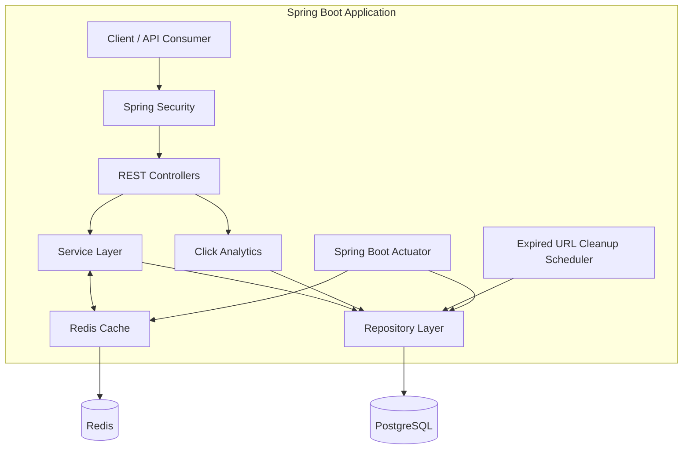

# URL Shortener

A RESTful URL Shortener application built using **Java 21, Spring Boot, PostgreSQL, and Redis**. The application allows users to create short URLs, redirect to original URLs, manage URL mappings, and track click statistics.

The project also includes Spring Security, Docker containerization, automated tests, and Spring Boot Actuator monitoring.

## Features

- **Short URL Generation:** Automatically generates unique short codes.
- **Custom Aliases:** Allows users to specify custom short URL aliases.
- **URL Expiration:** Supports optional expiration dates for short URLs.
- **URL Redirection:** Redirects short URLs to their original destinations using HTTP 302.
- **URL Management:** Create, update, delete, and retrieve URL mappings.
- **Pagination:** Supports paginated URL listing.
- **Click Analytics:** Tracks total clicks and daily click statistics.
- **Redis Caching:** Caches URL mappings to improve redirect performance.
- **Scheduled Cleanup:** Automatically removes expired URL records according to the configured retention policy.
- **Authentication and Authorization:** Protects administrative endpoints using Spring Security and HTTP Basic Authentication.
- **Health Monitoring:** Uses Spring Boot Actuator to monitor application, database, and Redis health.
- **Docker Support:** Runs the application, PostgreSQL, and Redis using Docker Compose.

## Technology Stack

| Technology | Purpose |
|---|---|
| Java 21 | Programming language |
| Spring Boot 4.1.1 | Backend framework |
| Spring MVC | REST API development |
| Spring Data JPA | Database persistence |
| Hibernate | ORM |
| PostgreSQL 17 | Relational database |
| Redis 7 | Caching |
| Spring Security | Authentication and authorization |
| Spring Boot Actuator | Monitoring and health checks |
| Maven | Build management |
| Docker | Containerization |
| Docker Compose | Multi-container orchestration |
| JUnit and Mockito | Automated testing |
| JaCoCo 0.8.14 | Code coverage reporting |

## Architecture



### Application Flow

1. A client sends a request to the REST API.
2. Spring Security checks the authentication and authorization requirements.
3. The controller delegates business operations to the service layer.
4. Redis is checked for cached URL mappings during redirects.
5. If a mapping is not cached, the application retrieves it from PostgreSQL.
6. Redirect requests return HTTP 302 and record click activity.
7. Click statistics are retrieved from the database.
8. A scheduled task cleans up expired URL records according to the configured retention period.

## REST API Documentation

**Base URL (local Docker):**

`http://localhost:8081`

### 1. Create a Short URL

**POST** `/api/urls`

Creates a new short URL. Supports automatically generated codes and custom aliases.

Request:

```json
{
  "originalUrl": "https://www.example.com/products",
  "expiresAt": "2026-12-31T23:59:59",
  "customAlias": "products"
}
```

`expiresAt` and `customAlias` are optional.

Response: `201 Created`

```json
{
  "shortCode": "products",
  "shortUrl": "http://localhost:8081/products",
  "originalUrl": "https://www.example.com/products",
  "createdAt": "2026-11-19T06:00:00",
  "expiresAt": "2026-12-31T23:59:59"
}
```

### 2. Redirect to Original URL

**GET** `/{shortCode}`

Redirects the short URL to its original destination.

Example:

`GET http://localhost:8081/products`

Response: `302 Found`

The original URL is provided in the `Location` response header.

This endpoint also records a click.

### 3. Update a Short URL

**PUT** `/api/urls/{shortCode}`

Updates the destination URL associated with an existing short code.

Request:

```json
{
  "originalUrl": "https://www.example.com/updated-products"
}
```

Response: `200 OK`

Returns the updated URL mapping.

### 4. Delete a Short URL

**DELETE** `/api/urls/{shortCode}`

Deletes a short URL and its associated click records.

Response: `204 No Content`

### 5. Retrieve All Short URLs

**GET** `/api/urls`

Returns URL mappings with pagination.

Query parameters:

| Parameter | Default | Description |
|---|---:|---|
| page | 0 | Zero-based page number |
| size | 10 | Number of records per page (maximum 100) |

Example:

`GET /api/urls?page=0&size=10`

Response: `200 OK`

Returns a paginated response containing URL mappings and page metadata.

### 6. Retrieve Click Statistics

**GET** `/api/urls/{shortCode}/stats`

Returns total clicks and daily click statistics for a short URL.

Example:

`GET /api/urls/products/stats`

Response: `200 OK`

```json
{
  "shortCode": "products",
  "totalClicks": 25,
  "dailyClicks": [
    {
      "date": "2026-11-18",
      "clicks": 10
    },
    {
      "date": "2026-11-19",
      "clicks": 15
    }
  ]
}
```

The values above are illustrative.

## Security

Spring Security protects administrative API operations.

| Endpoint | Access |
|---|---|
| POST `/api/urls` | Public |
| GET `/{shortCode}` | Public |
| PUT `/api/urls/{shortCode}` | Admin |
| DELETE `/api/urls/{shortCode}` | Admin |
| GET `/api/urls` | Admin |
| GET `/api/urls/{shortCode}/stats` | Admin |

Additional security features:

- HTTP Basic Authentication.
- BCrypt password encoding.
- Stateless session management.
- Environment-based admin credentials.
- Protected Actuator information and metrics.

The admin account is configured using environment variables and stored in an in-memory user store.

**Production note:** Use HTTPS when transmitting Basic Authentication credentials. Configure strong, unique credentials before deployment.

## Project Structure

```text
URL_Shortner/
│
├── src/
│   ├── main/
│   │   ├── java/com/github/deepthi/
│   │   │   ├── config/
│   │   │   │   ├── RedisConfig.java
│   │   │   │   └── SecurityConfig.java
│   │   │   ├── controller/
│   │   │   ├── dto/
│   │   │   ├── entity/
│   │   │   ├── exception/
│   │   │   ├── repository/
│   │   │   ├── scheduler/
│   │   │   ├── service/
│   │   │   └── UrlShortnerApplication.java
│   │   │
│   │   └── resources/
│   │       └── application.properties
│   │
│   └── test/
│       └── java/com/github/deepthi/
│
├── .dockerignore
├── .env.example
├── .gitignore
├── Dockerfile
├── compose.yaml
├── pom.xml
└── README.md
```

## Getting Started

### Prerequisites

For local development:

- Java 21
- Maven
- PostgreSQL 17
- Redis 7

For containerized execution:

- Docker Desktop
- Docker Compose

### 1. Clone the Repository

```bash
git clone https://github.com/bdeepthi25/URL_Shortner.git
cd URL_Shortner
```

### 2. Configure Environment Variables

Create a local `.env` file using the example template:

**Windows CMD:**

```cmd
copy .env.example .env
```

Update `.env` with your own credentials:

```dotenv
DB_USERNAME=your_database_username
DB_PASSWORD=your_strong_database_password

ADMIN_USERNAME=your_admin_username
ADMIN_PASSWORD=your_strong_admin_password
```

Never commit your actual `.env` file.

### 3. Run Using Docker Compose

Build and start all services:

```bash
docker compose up --build -d
```

This starts:

| Service | Container port | Host port |
|---|---:|---:|
| Spring Boot | 8080 | 8081 |
| PostgreSQL | 5432 | 5432 |
| Redis | 6379 | Internal Docker network |

Check service status:

```bash
docker compose ps
```

View application logs:

```bash
docker compose logs -f app
```

Access the application:

`http://localhost:8081`

### 4. Verify Application Health

```bash
curl http://localhost:8081/actuator/health
```

The health endpoint reports the application health status.

Detailed database and Redis health information requires admin authentication.

### 5. Stop Docker Services

```bash
docker compose down
```

This stops and removes the containers while preserving named volumes.

To remove persistent database and Redis data as well, Docker volumes must be explicitly removed. Do this only when you intend to delete that data.

## Running Locally Without Docker

1. Install and start PostgreSQL and Redis.
2. Create the `urlshortener` PostgreSQL database.
3. Configure the required environment variables.
4. Ensure the Redis host and port are configured for the local environment.
5. Run the application using Maven:

```bash
mvn spring-boot:run
```

The application starts on port `8080` by default when run outside the Docker Compose port mapping.

## Running Tests

Run the complete test suite:

**Windows CMD:**

```cmd
mvnw.cmd clean verify
```

**Linux/macOS:**

```bash
./mvnw clean verify
```

The verification process runs the automated tests, packages the application, and generates the JaCoCo coverage report.

Coverage report:

`target/site/jacoco/index.html`

The project includes unit tests and integration tests for controllers, services, repositories, security, Redis configuration, and database schema behavior.

## Configuration

The application uses environment-based configuration for sensitive values.

| Variable | Purpose |
|---|---|
| DB_URL | PostgreSQL JDBC connection URL |
| DB_USERNAME | Database username |
| DB_PASSWORD | Database password |
| ADMIN_USERNAME | Administrator username |
| ADMIN_PASSWORD | Administrator password |
| REDIS_HOST | Redis hostname |
| REDIS_PORT | Redis port |

Other application settings, such as cache expiration, expired URL retention, and cleanup scheduling, are configured in `application.properties`.

## Docker Design

The project uses a multi-stage Dockerfile:

- **Build stage:** Builds the Spring Boot application using Maven and Java 21.
- **Runtime stage:** Runs the packaged application using a Java 21 JRE image.
- Runs the application as a non-root user.

Docker Compose orchestrates:

- Spring Boot application
- PostgreSQL database
- Redis cache
- Persistent PostgreSQL and Redis volumes
- Service health checks and startup dependencies

## Future Improvements

Potential enhancements for future development:

- Rate limiting for public URL creation.
- API documentation using OpenAPI/Swagger.
- URL access expiration and analytics enhancements.
- Centralized logging and monitoring.
- Cloud deployment and CI/CD automation.

## Author

**Deepthi Battala**

GitHub: https://github.com/bdeepthi25

---

*This project was developed as a hands-on backend engineering project to explore REST API development, Spring Boot, database persistence, caching, security, testing, and Docker-based deployment.*URL_Shortner/
|
+-- src/
|   +-- main/
|   |   +-- java/com/github/deepthi/
|   |   |   +-- config/
|   |   |   |   +-- RedisConfig.java
|   |   |   |   +-- SecurityConfig.java
|   |   |   +-- controller/
|   |   |   +-- dto/
|   |   |   +-- entity/
|   |   |   +-- exception/
|   |   |   +-- repository/
|   |   |   +-- scheduler/
|   |   |   +-- service/
|   |   |   +-- UrlShortnerApplication.java
|   |   |
|   |   +-- resources/
|   |       +-- application.properties
|   |
|   +-- test/
|       +-- java/com/github/deepthi/
|
+-- .dockerignore
+-- .env.example
+-- .gitignore
+-- Dockerfile
+-- compose.yaml
+-- pom.xml
+-- README.md